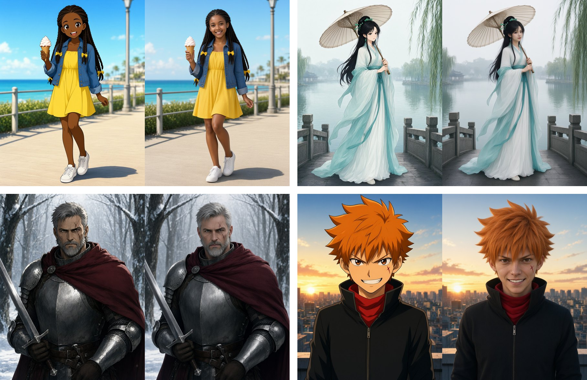

# Anime to Real

One anime, cartoon or game character image in, the same picture as a real photo out: same pose, framing and scene,
with the character as a real person and the background as a real place. Generation runs through the Video Factory
cloud API with Qwen-Image 2.1 Turbo; no GPU or model download needed.

[中文](README.zh.md)

## Install

1. Install the Qwen-Image 2.1 node and configure an API key, see [Video Factory nodes](../../README.md#video-factory-nodes).
2. Download the zip from [Releases](https://github.com/wangxunx/FlowFactory/releases), or drag `anime-to-real.json` from this folder onto the ComfyUI canvas.

## Use

Load your character image in `Load Image`, set `aspect_ratio` on the Qwen node to the shape of your image, and run.
The photo is reframed to that aspect ratio, so a mismatch crops or extends the scene. To try the sample first, upload
`assets/anime_sample.jpg`, a generated character.

The prompt starts with `transform the image to a realistic photograph`, the trigger phrase popular anime-to-real
workflows use. It then asks to keep the composition, pose and background layout, and the character's hair, eye
color, expression, outfit and anything they hold; to give them normal human proportions, real skin, real hair rather
than a wig and little makeup; and to avoid a cosplay, doll or 3D-render look.

**Extra instructions** are appended to the prompt. Leave them empty, or steer the result in a few words: `a man` if
the gender comes out wrong, or `Western features`, `East Asian features` or another look you want.

Results go to `output/anime_to_real/`: `real_*.png`, and `before_after_*.png` with the original and the photo side by
side for sharing. The seed is fixed, so running again with the same image and instructions reuses the last result.
Change the `seed` for a new take, also when a result still looks drawn or 3D-rendered: in testing, about one seed in
five left a 3D cartoon character nearly unchanged.

Anime, game and semi-realistic characters work best. Chibi characters keep their big-head proportions and look
uncanny; the model keeps the composition rather than redrawing the body.

## Model

Each run makes 1 image with `Qwen-Image-2.1-Turbo`, 1 credit, in about 50 seconds. You can switch the node to
`Qwen-Image-2.1` with adjustable steps; it is slower and in testing gave nearly the same result.

## Change the workflow

The prompt lives in `build.py`. Edit it there and run `python build.py` to rewrite `anime-to-real.json`. `tests/` has
8 test characters and a runner, see [tests/README.md](tests/README.md).
