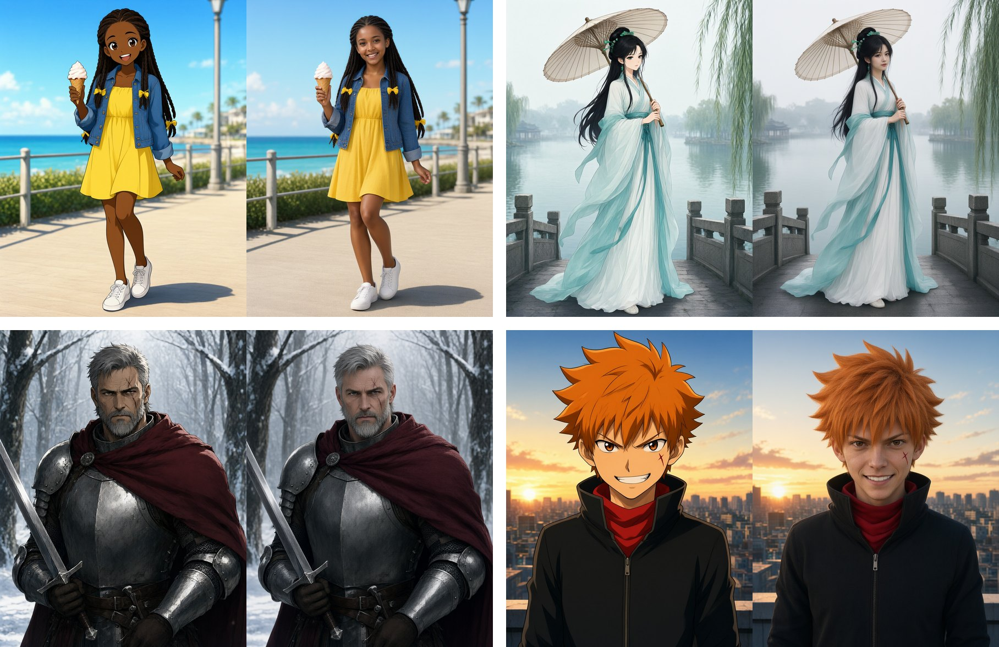

# 动漫转真人

一张动漫、卡通或游戏角色图，一次运行得到同一张图的真人照片：姿势、取景和场景不变，角色变成真人，背景变成真实场景。生成通过 Video Factory 云端 API 调用 Qwen-Image 2.1 Turbo，不需要显卡，也不用下载模型。

[English](README.md)

## 安装

1. 按 [Video Factory 节点](../../README.zh.md#video-factory-节点) 一节安装 Qwen-Image 2.1 节点并配好 API key。
2. 在 [Releases](https://github.com/wangxunx/FlowFactory/releases) 下载 zip，或者直接用本目录里的 `anime-to-real.json`，拖进 ComfyUI 画布。

## 使用

在 `Load Image` 节点载入你的角色图，把 Qwen 节点的 `aspect_ratio` 设成和原图一样的比例，运行。输出会按这个比例重新取景，比例不一致时画面会被裁掉或往外延伸。想先用示例图试一下，就上传 `assets/anime_sample.jpg`，这是一张 AI 生成的角色图。

提示词以 `transform the image to a realistic photograph` 开头，这是热门动漫转真人工作流通用的触发句。后面要求保持构图、姿势和背景布局，保持发型发色、瞳色、表情、服装和手里拿的东西；人体比例正常，真实皮肤，真实发丝而不是假发，淡妆或素颜；不要 cosplay、娃娃或 3D 渲染的质感。

**补充要求**会追加到提示词末尾。可以留空，也可以用几个词调整：性别识别错了写 `a man`；想要欧美面孔写 `Western features`，东亚面孔写 `East Asian features`。

结果在 `output/anime_to_real/`：真人照片 `real_*.png`，以及原图和真人照片左右拼在一起的 `before_after_*.png`，方便分享。seed 固定，图和补充要求不变时再次运行会复用上次的结果。想换一版，或者结果看起来还像画的、像 3D 渲染，就改 seed：测试中 3D 卡通角色大约每五个 seed 有一个几乎没变。

动漫、游戏和半写实风格的角色效果最好。Q 版角色会保留大头小身的比例，看着别扭：模型保持原构图，不会重画身体比例。

## 模型

每次运行用 `Qwen-Image-2.1-Turbo` 生成 1 张图，1 credit，大约 50 秒。节点也可以切换到 `Qwen-Image-2.1`，步数可调，速度更慢，测试中结果和 Turbo 几乎一样。

## 修改工作流

提示词在 `build.py` 里。在那里修改后运行 `python build.py`，会重写 `anime-to-real.json`。`tests/` 里有 8 个测试角色和运行脚本，见 [tests/README.md](tests/README.md)。
