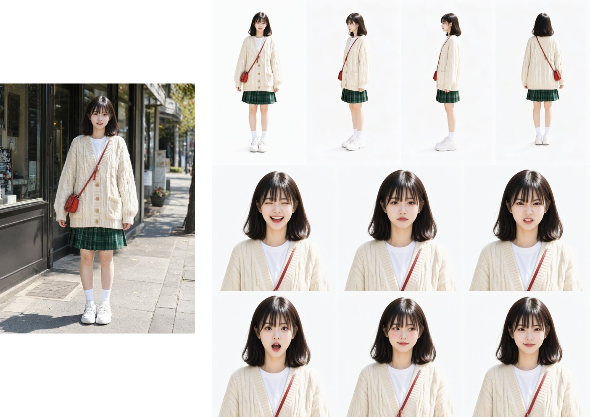
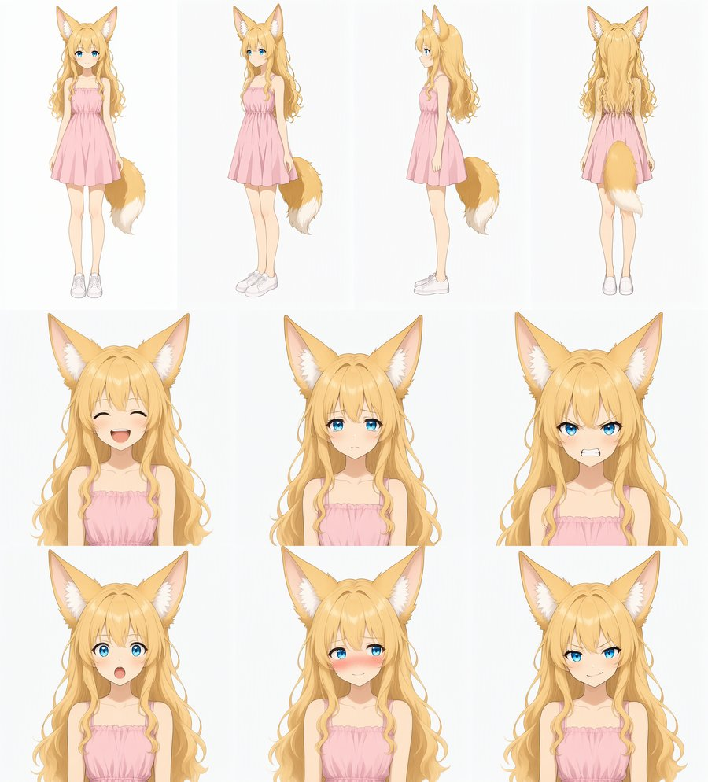

# Character Sheet

Turns one character into a full character design sheet: front, three-quarter, side and back views, plus six
expressions, stitched into a single image. Generation runs on Qwen-Image 2.1 through the Video Factory cloud API, so
no GPU or model download is needed.

[中文说明](README.zh.md)

| Workflow | Start from |
|---|---|
| `character-sheet-from-image.json` | An image of your character: a photo, a finished illustration or a rough drawing |
| `character-sheet-from-text.json` | A text description of your character |

## Install

1. Install the Qwen-Image 2.1 node and set up your API key, as described under
   [Video Factory nodes](../../README.md#video-factory-nodes).
2. Download the zip from [Releases](https://github.com/wangxunx/FlowFactory/releases), or take a JSON from this folder,
   and drag it onto the ComfyUI canvas.

## Use

- **From image**: load your picture in the `Load Image` node and run. To try the sample photo first, upload
  `assets/character_sheet_model.jpg`; it is AI-generated, not a real person.
- **From text**: replace the `Character:` line in the `Front view` node's prompt and run. Keep the rest of that prompt,
  which fixes the pose and the white background.

The workflow first redraws the character as a clean full-body front view. That image is the first panel of the sheet
and the reference for the other nine panels, which keeps them consistent with each other. The nine panels run in
parallel.

Results go to `output/character_sheet/`: `sheet_*.png` is the full sheet (3072x3392), `front_*.png` the front view on
its own, which works well as the reference image for later image or video workflows.

To redo a single panel, edit a word in that panel's prompt and run again. ComfyUI reuses the cached results of every
unchanged node, so only that panel is regenerated.

To change the art style, edit the front view prompt; the other panels follow the front view.

Works best with one character per picture. Anything the picture does not show, such as the legs in a portrait or the
back, is invented. Items on the far side of the body may be missing from the side view, and a pose such as hands in
pockets is kept from the picture. A character whose face is hidden under a hat or hood may not turn around in the back
view.

## Model

One run generates 10 images. The default model is `Qwen-Image-2.1-Turbo`; switch any node to `Qwen-Image-2.1` for
slower, higher-step generation.

## Editing the workflows

The prompts for both workflows live in `build.py`. Edit them there and run `python build.py` to rewrite the two JSON
files. `tests/` has 7 regression inputs and a runner; see [tests/README.md](tests/README.md).
