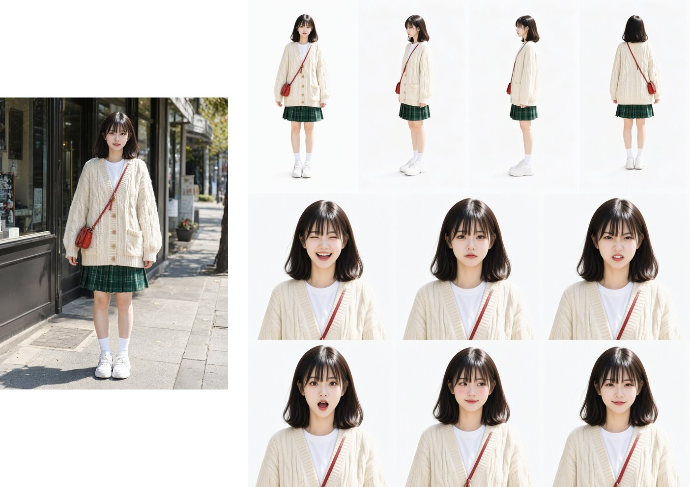
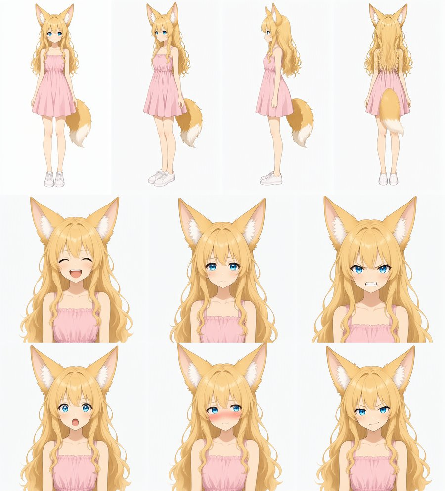

# 角色设定图

从一个角色生成正面、四分之三侧、正侧、背面四视图和六种表情，拼成一张完整的设定图。生成通过 Video Factory 云端 API 调用 Qwen-Image 2.1，不需要显卡，也不用下载模型。

[English](README.md)

| 工作流 | 起点 |
|---|---|
| `character-sheet-from-image.json` | 一张角色图：照片、成品插画或随手涂鸦都可以 |
| `character-sheet-from-text.json` | 一段角色文字描述 |

## 安装

1. 按 [Video Factory 节点](../../README.zh.md#video-factory-节点) 一节安装 Qwen-Image 2.1 节点并配好 API key。
2. 在 [Releases](https://github.com/wangxunx/FlowFactory/releases) 下载 zip，或者直接用本目录里的 JSON，拖进 ComfyUI 画布。

## 使用

- **从图片**：在 `Load Image` 节点载入你的图，运行。想先用示例照片试一下，就上传 `assets/character_sheet_model.jpg`；它由 AI 生成，不是真人。
- **从文字**：把 `Front view` 节点提示词里 `Character:` 那一行换成你的角色描述，运行。其余文字保持不变，它固定了站姿和白底。

工作流先把角色重绘成干净的正面全身图。这张图既是设定图的第一格，也是其余九格的参考图，各格之间因此保持一致。九格并行生成。

结果在 `output/character_sheet/`：`sheet_*.png` 是整张设定图（3072x3392），`front_*.png` 是单独的正面图，适合作为后续图片或视频工作流的参考图。

想重做某一格，改动那一格提示词里的任意一个词再运行。ComfyUI 会复用所有未改动节点的缓存，只重新生成这一格。

想换画风，改正面图的提示词，其余各格会跟随正面图。

一张图只放一个角色效果最好。图里没拍到的部分（比如半身照的腿、角色的背面）由模型补全；被身体挡住的配饰在侧面图里可能缺失；双手插兜这类姿势会保留原图的样子；脸被帽子或兜帽遮住的角色，背面图可能转不过身。

## 模型

每次运行生成 10 张图。默认模型是 `Qwen-Image-2.1-Turbo`；任意节点可切换到 `Qwen-Image-2.1`，步数可调，速度更慢。

## 修改工作流

两个工作流的提示词都在 `build.py` 里。在那里修改后运行 `python build.py`，会重写两个 JSON 文件。`tests/` 里有 5 张回归测试图和运行脚本，见 [tests/README.md](tests/README.md)。
