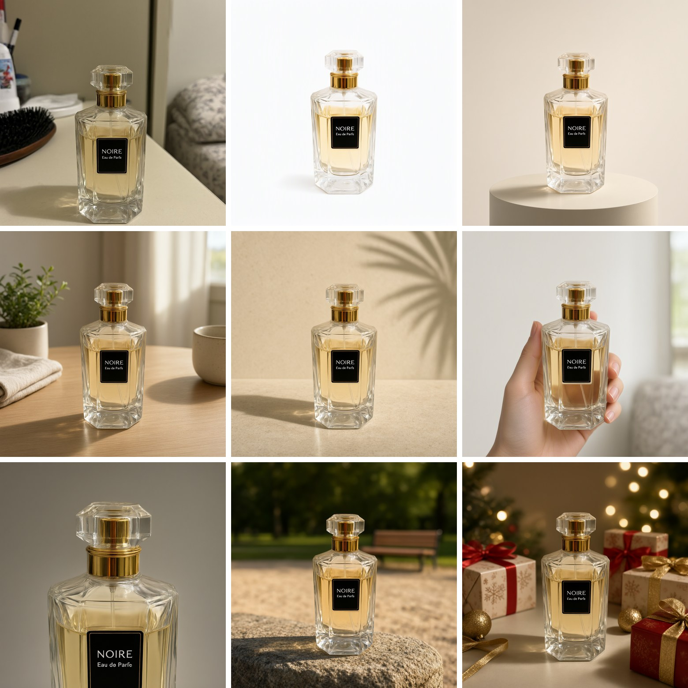
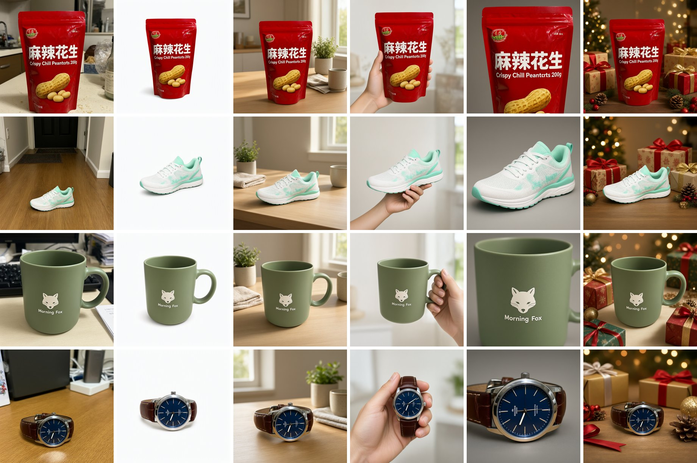

# Product Scenes

Turns one photo of a product, even a quick phone snapshot, into eight product images in one run. Generation runs on
Qwen-Image 2.1 through the Video Factory cloud API, so no GPU or model download is needed.

[中文说明](README.zh.md)

| Scene | Use it for |
|---|---|
| White background | Marketplace main image: product alone on pure white |
| Studio podium | Hero shot on a podium with a backdrop matched to the product's colors |
| Tabletop | Lifestyle shot on a sunlit wooden table at home |
| Leaf shadows | Minimal shot on warm stone with sunlight and palm-leaf shadows |
| In hand | A hand holding the product, to show its size |
| Close-up detail | Macro shot of the label and material on a grey studio backdrop |
| Outdoor | Golden-hour shot outdoors |
| Festive gift | Holiday gift arrangement |

## Install

1. Install the Qwen-Image 2.1 node and set up your API key, as described under
   [Video Factory nodes](../../README.md#video-factory-nodes).
2. Download the zip from [Releases](https://github.com/wangxunx/FlowFactory/releases), or take
   `product-scenes.json` from this folder, and drag it onto the ComfyUI canvas.

## Use

Load your product photo in the `Load Image` node and run. To try the sample first, upload
`assets/product_sample.jpg`, a generated phone photo of a perfume bottle.

All eight scenes are generated in parallel from your photo. Each prompt starts with one sentence that describes the
scene, followed by the same instructions in every node: keep the product's shape, colors, logo and printed text
unchanged, and relight it to match the scene with natural reflections and a contact shadow. To make a scene your
own, such as a Lunar New Year table instead of the holiday gifts, rewrite only that first sentence. Run again and
only the changed scenes are regenerated.

Results go to `output/product_scenes/`, one 1024x1024 image per scene, named after it (`white_background_*.png`,
`studio_*.png`, ...). Square suits marketplace main images; set a node's `aspect_ratio` to `3:4` or `9:16` for social
posts.

Works best with one product per photo and its label facing the camera. Printed text is kept very faithfully, even
small print and spelling mistakes on the original. Very small print can drift in the close-up, a product without any
text may get a few invented characters on the white background or the close-up, and a product photographed from the
side keeps that angle.

## Model

One run generates 8 images. The default model is `Qwen-Image-2.1-Turbo`; switch any node to `Qwen-Image-2.1` for
slower, higher-step generation.

## Editing the workflow

The prompts live in `build.py`. Edit them there and run `python build.py` to rewrite `product-scenes.json`. `tests/`
has 10 regression inputs and a runner; see [tests/README.md](tests/README.md).
