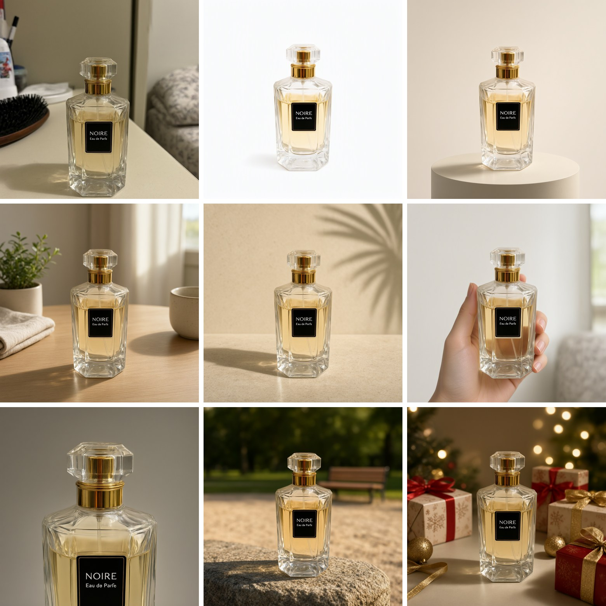
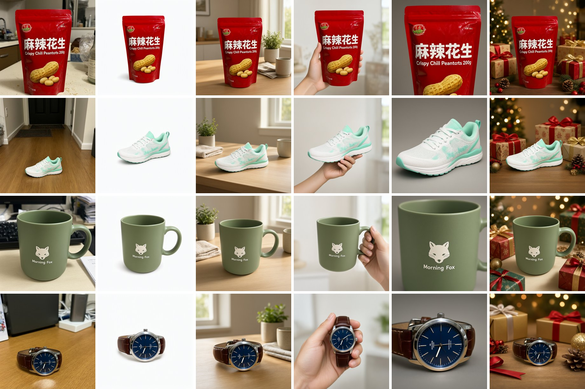

# 商品场景图

一张商品照片（手机随手拍即可），一次运行生成八张商品图。生成通过 Video Factory 云端 API 调用 Qwen-Image 2.1，不需要显卡，也不用下载模型。

[English](README.md)

| 场景 | 用途 |
|---|---|
| White background | 电商主图：纯白底，只有商品 |
| Studio podium | 展台棚拍，背景色和商品配色协调 |
| Tabletop | 生活场景：家里洒满阳光的木桌 |
| Leaf shadows | 极简风：暖色石台，阳光和棕榈叶影 |
| In hand | 手持商品，展示实际大小 |
| Close-up detail | 标签和材质的微距特写，灰色棚拍背景 |
| Outdoor | 户外夕阳暖光 |
| Festive gift | 节日礼物布景 |

## 安装

1. 按 [Video Factory 节点](../../README.zh.md#video-factory-节点) 一节安装 Qwen-Image 2.1 节点并配好 API key。
2. 在 [Releases](https://github.com/wangxunx/FlowFactory/releases) 下载 zip，或者直接用本目录里的 `product-scenes.json`，拖进 ComfyUI 画布。

## 使用

在 `Load Image` 节点载入你的商品照片，运行。想先用示例图试一下，就上传 `assets/product_sample.jpg`，这是一张 AI 生成的香水瓶手机照。

八个场景都从你的照片出发并行生成。每个提示词的第一句描述场景，后面是所有节点相同的要求：商品的外形、颜色、logo 和印刷文字保持不变，并按场景重新打光，带自然的反光和接触阴影。想换成自己的场景（比如把节日礼物换成春节年货），只改第一句。再次运行时只重新生成改过的场景。

结果在 `output/product_scenes/`，每个场景一张 1024x1024 的图，按场景命名（`white_background_*.png`、`studio_*.png` 等）。方图适合电商主图；发小红书或抖音可把节点的 `aspect_ratio` 改成 `3:4` 或 `9:16`。

一张照片只放一件商品、标签朝向镜头效果最好。印刷文字保留得非常忠实，连小字和原图上的错别字都会照搬。特写里极小的字可能走样；本身没有文字的商品，白底图或特写里偶尔会多出几个字；侧面拍的商品会保持侧面角度。

## 模型

每次运行生成 8 张图。默认模型是 `Qwen-Image-2.1-Turbo`；任意节点可切换到 `Qwen-Image-2.1`，步数可调，速度更慢。

## 修改工作流

提示词都在 `build.py` 里。在那里修改后运行 `python build.py`，会重写 `product-scenes.json`。`tests/` 里有 10 张回归测试图和运行脚本，见 [tests/README.md](tests/README.md)。
